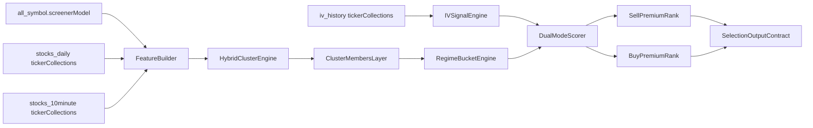

# Factor-Based Peer Classification Spec

This specification replaces strict peer matching with a hybrid factor-classification model for 10-20 day swing-trade stock selection.

Scope: strategy design only (no code implementation in this document).

---

## 1) Objective

Build a robust selection framework that:

- classifies stocks into similarity-based peer clusters,
- ranks candidates within market-regime buckets,
- outputs dual-mode opportunity lists for options workflows:
  - `sell-premium` mode,
  - `buy-premium` mode.

Sparse-data behavior is strict: if required inputs are missing or stale, the stock is dropped from ranking.

---

## 2) Input Data and Feature Sources

Use the existing datasets documented in [`STOCK_SELECTION_DATA_TABLES.md`](STOCK_SELECTION_DATA_TABLES.md):

- fundamentals: `all_symbol.screenerModel`,
- daily price and liquidity: `stocks_daily.<TICKER>`,
- intraday behavior: `stocks_10minute.<TICKER>`,
- options regime context: `iv_history.<TICKER>`.

Reference integration points:

- [`backend/src/my_libs_py3/my_data.py`](backend/src/my_libs_py3/my_data.py)
- [`backend/src/analytics/analysis.py`](backend/src/analytics/analysis.py)
- [`backend/src/my_libs_py3/TradingPlan.py`](backend/src/my_libs_py3/TradingPlan.py)
- [`IV_AND_IV_RANK.md`](IV_AND_IV_RANK.md)

---

## 3) Feature Schema (Hybrid Peer Classification)

## 3.1 Structural Features

- `sector_one_hot`: encoded `Sector`
- `industry_one_hot`: encoded `Industry`
- `market_cap_bucket`: `{micro, small, mid, large, mega}` from `Market_cap`

Structural features are soft priors, not hard peer boundaries.

## 3.2 Market Behavior Features (10-20 day swing horizon)

From `stocks_daily`:

- `ret_10d`, `ret_20d`
- `vol_20d`: realized volatility using daily log returns
- `trend_20_60`: normalized trend proxy (`SMA20/SMA60 - 1`)
- `drawdown_20d`: recent peak-to-trough drawdown

From `stocks_10minute` (optional but preferred):

- `intraday_vol_5d`: realized intraday vol aggregate
- `intraday_trend_5d`: short trend confirmation

## 3.3 Liquidity Features

- `adv20_shares`: 20-day average volume
- `adv20_dollar`: 20-day average dollar volume (`Close * Volume`)
- `volume_stability`: inverse coefficient of variation of recent volume

## 3.4 Fundamental Composite Features

From `all_symbol.screenerModel`:

- value: `P/E`, `P/S`, `P/Cash`, `P/Free Cash Flow`
- quality: `Gross Margin`, `Operating Margin`, `Profit Margin`, `EPS (ttm)`
- resilience: `Current Ratio`, `Quick Ratio`, `Total Debt/Equity`
- positioning: `Institutional Ownership`, `Insider Ownership`, `Analyst Recom`

Convert raw columns to standardized component scores:

- `value_score`
- `quality_score`
- `resilience_score`
- `positioning_score`

## 3.5 Options Regime Features

From `iv_history`:

- `iv_rank` (existing methodology),
- `spot_iv`,
- `iv_term_slope` (`iv_30d - iv_7d`, if available).

---

## 4) Preprocessing Rules

1. Winsorize numeric features at 1st/99th percentile.
2. Impute missing numeric values with feature median only when missingness is below 15%.
3. For features with missingness above 15%, mark feature unavailable and reduce confidence.
4. Scale numeric features with robust scaler (`median/IQR`).
5. Keep categorical priors (`Sector`, `Industry`, cap bucket) as encoded sparse vectors.

Required minimum completeness per stock:

- at least 85% of mandatory features present,
- valid `Refresh_Date` recency for fundamentals,
- enough price bars to compute 20-day metrics.

Stocks failing these rules are excluded.

---

## 5) Hybrid Cluster Method

## 5.1 Hybrid Similarity Logic

Distance combines:

- `D_factor`: weighted Euclidean distance over scaled numeric factor features,
- `D_context`: penalty term for structural mismatch.

Composite distance:

`D_total = 0.85 * D_factor + 0.15 * D_context`

Context penalty definition:

- same industry: penalty `0.0`
- same sector, different industry: penalty `0.35`
- different sector: penalty `0.75`

This keeps cross-industry peers possible when factor similarity is strong.

## 5.2 Clustering Choice

Use a two-step clustering design:

1. global density or centroid pre-clustering on `D_total`,
2. post-merge small clusters into nearest valid cluster by centroid distance.

The exact algorithm can be KMeans/GMM/HDBSCAN at implementation time, but these constraints must hold.

## 5.3 Cluster Quality Constraints

- minimum cluster size: `12` stocks
- preferred size range: `20-80`
- maximum intra-cluster dispersion threshold on `D_total`
- cluster coherence score must be above threshold (for example silhouette-like metric)

If a stock ends up in a low-quality or undersized cluster after merge attempts, drop the stock.

Peer output for each stock:

- `cluster_id`
- `cluster_size`
- `cluster_coherence`
- `cluster_regime_label`

Peers are all names in the same cluster (`cluster-members` output mode).

---

## 6) Market-Regime Bucket Layer

After clustering, assign each stock to a regime bucket:

- `calm_trend`: low vol + positive trend,
- `volatile_trend`: high vol + positive trend,
- `calm_mean_revert`: low vol + weak trend,
- `stress`: high vol + negative trend/drawdown.

Regime inputs:

- `vol_20d` percentile,
- `ret_20d`,
- `drawdown_20d`,
- market proxy state (for example SPY 20d/60d trend and VIX bucket if available).

Ranking is performed within cluster and regime to avoid mixing incompatible setups.

---

## 7) Dual-Mode Swing Ranking

Final score is mode-specific and uses within-cluster normalized factors.

## 7.1 Shared Base Components

- `fundamental_composite`
- `trend_composite`
- `liquidity_composite`
- `stability_composite` (inverse drawdown and vol shock)

## 7.2 Sell-Premium Mode

Target profile: stable/uptrend names with elevated IV.

`score_sell = 0.30*fundamental_composite + 0.25*trend_composite + 0.15*liquidity_composite + 0.15*stability_composite + 0.15*iv_expensive_score`

Where `iv_expensive_score` increases with `iv_rank` and penalizes extreme instability.

## 7.3 Buy-Premium Mode

Target profile: improving trend names with relatively cheap IV.

`score_buy = 0.25*fundamental_composite + 0.30*trend_accel_composite + 0.15*liquidity_composite + 0.10*stability_composite + 0.20*iv_cheap_score`

Where:

- `trend_accel_composite` rewards 10d vs 20d trend improvement,
- `iv_cheap_score` increases as `iv_rank` declines.

## 7.4 Rank Output

Produce two ranked lists per run:

- `sell_premium_ranked`
- `buy_premium_ranked`

Each list includes cluster-relative rank and global rank.

---

## 8) Exclusions and Hard Drop Rules

A stock is excluded immediately if any condition is true:

1. Missing `Sector` or `Industry`.
2. Fundamental snapshot stale beyond configured freshness window.
3. Fewer than required daily bars for 20-day metrics.
4. Missing `iv_rank` in mode where IV overlay is mandatory.
5. Liquidity below minimum floor (`adv20_dollar` threshold).
6. Cluster assignment fails quality constraints.
7. Data completeness below minimum threshold.

No fallback substitution ranking is used; excluded names are dropped.

---

## 9) Output Contract

Each ranked stock record should include:

- `ticker`
- `as_of_date`
- `mode` (`sell_premium` or `buy_premium`)
- `cluster_id`, `cluster_size`, `cluster_coherence`
- `regime_bucket`
- `fundamental_composite`, `trend_composite`, `liquidity_composite`
- `iv_rank`, `iv_signal_score`
- `selection_score`
- `cluster_rank`, `global_rank`
- `confidence_score`
- `reasons` (positive drivers)
- `exclusion_reasons` (if dropped)

---

## 10) Confidence Score

Define:

`confidence = 0.45*data_completeness + 0.35*cluster_coherence + 0.20*signal_alignment`

Where:

- `data_completeness`: fraction of required features present,
- `cluster_coherence`: normalized cluster quality metric,
- `signal_alignment`: agreement between trend/fundamental/IV signals for selected mode.

---

## 11) Implementation Handoff (Design-Only)

Recommended build modules:

1. `backend/src/analytics/peer_classification.py`
   - feature engineering
   - scaling/imputation
   - clustering and cluster diagnostics

2. `backend/src/analytics/swing_ranker.py`
   - regime assignment
   - dual-mode scoring
   - confidence and reason-code generation

3. `backend/src/services/selection_service.py`
   - orchestrate data loading and model execution
   - produce output payloads

4. `backend/src/models/selection_models.py`
   - request/response schema for run controls and output contract

5. `backend/src/routers/selection.py`
   - expose run endpoint and retrieval endpoint

6. `Notebooks/test_stock_selection.ipynb`
   - local validation for feature extraction, clustering stability, and mode ranking checks

---

## 12) Data Flow Diagram

